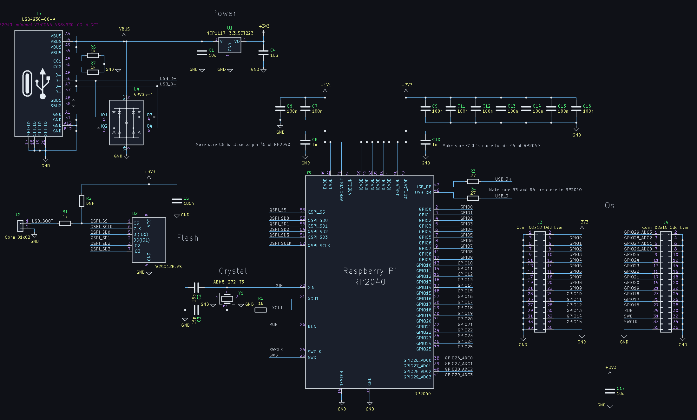
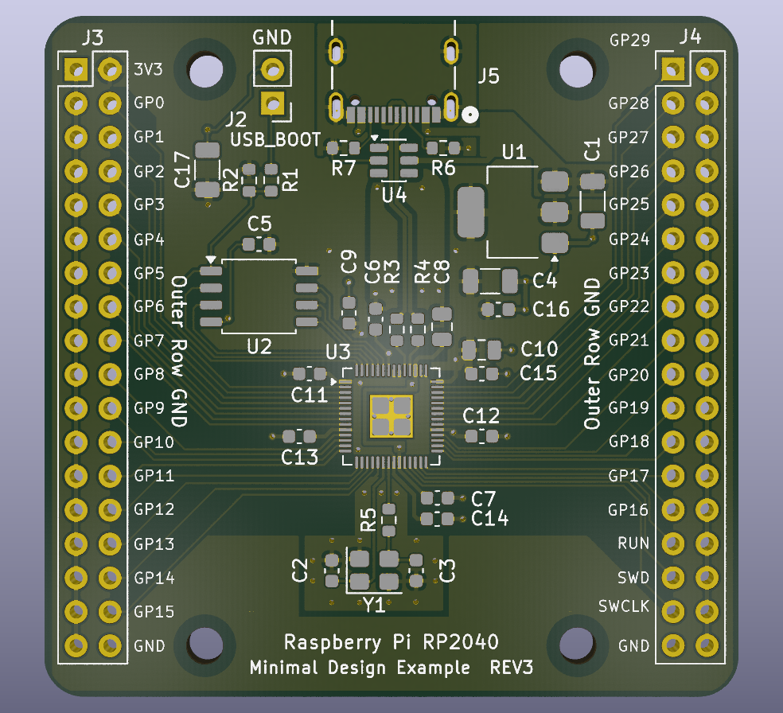

# RP2040 Minimal Projects for KiCad

This repository contains modified versions of the Raspberry Pi RP2040 Minimal design, that are better for production.

The modified versions are more suited to recent KiCad versions (for instance KiCad 10), and they improves things if the board is to be produced; for example, one version uses 0603 parts rather than 0402 for higher reliability, and another version uses 0402 parts but has a layout that will reduce the chance of 0402 parts rotating/sliding/tombstoning, compared to the original Raspberry Pi original design. The modified versions use USB C connectors rather than Micro USB, and include better ESD protection.

The RP2040_minimal-edit_V3 by [Gerald](https://community.element14.com/members/geralds) retains the PCB outline and GPIO connectors as on the original Raspberry Pi design, but uses 0603 parts and USB C connector, and improved layout. The rp2040_custom_minimal design removes the original PCB outline and the GPIO connectors, but retains 0402 parts. 

# RP2040_minimal-edit_V3

## Schematic

## PCB Layout

The image here shows the top side copper.

Underside:

## 3D Render

# rp2040_custom_minimal design

## Schematic

The schematic includes the RP2040 microcontroller along with supporting circuitry. The USB connector is USB-C, unlike the original Micro USB. 

**NOTE**: The GPIO connectors from the original schematic have been removed, so that the schematic is ready for custom additions.

## PCB Layout

The image here shows the top side copper. The bottom side is nearly all ground plane, apart from a few traces that carry 1.1V core power, and one at the USB-C connector end to allow cables to be inserted in any orientation.

## 3D Render

