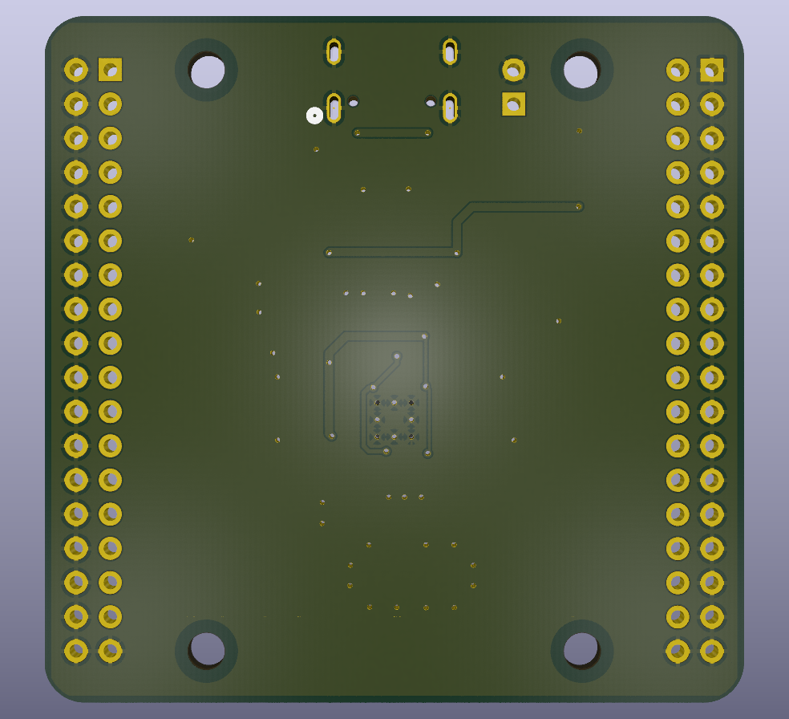
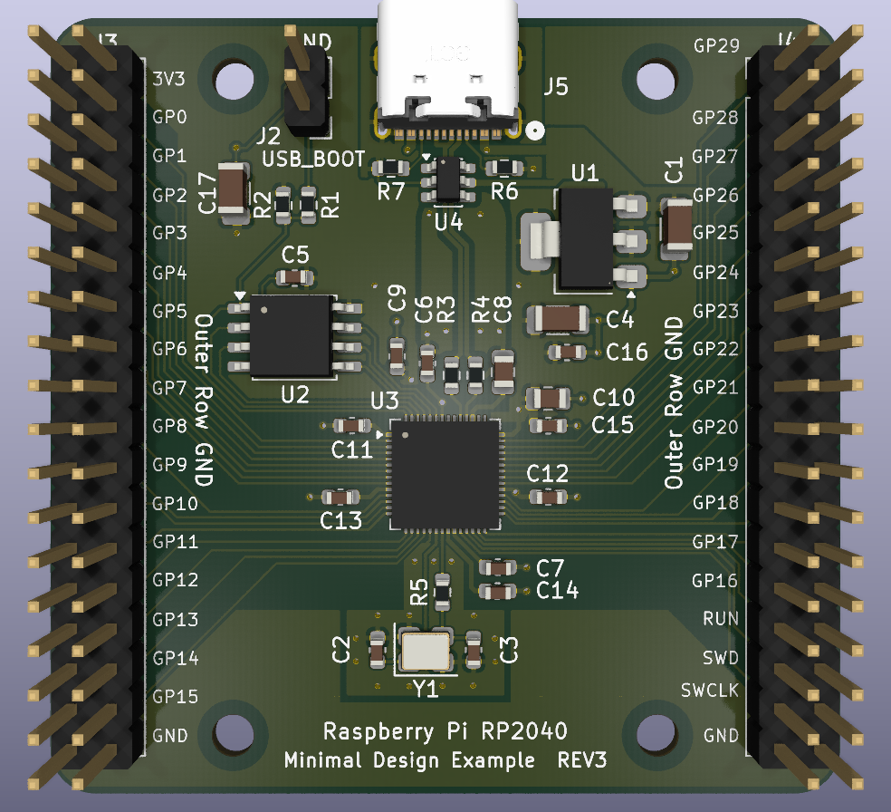
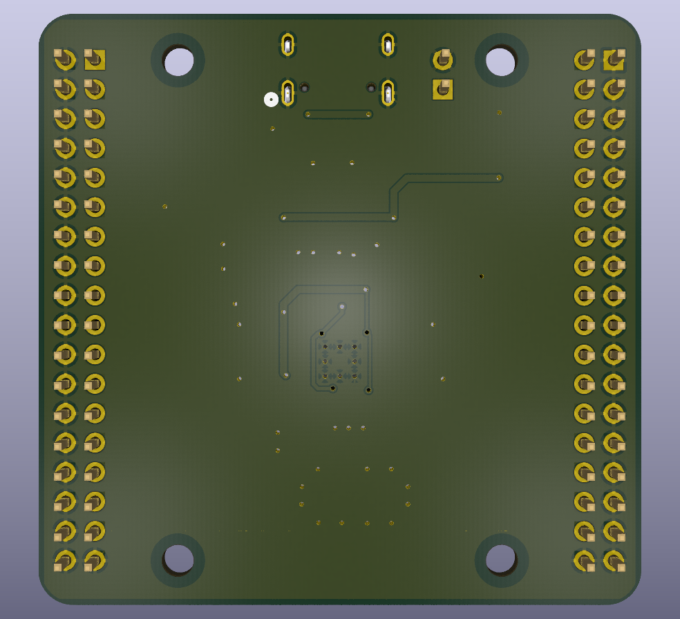

# RP2040 Minimal Project for KiCad

This repository contains a modified version of the Raspberry Pi RP2040 Minimal design for KiCad.

The RP2040_minimal-edit_V3 design by [Gerald](https://community.element14.com/members/geralds) retains the original PCB outline and GPIO connectors, with an improved layout, 0603 parts instead of 0402, a USB-C connector instead of Micro USB, and improved ESD protection.

## Schematic

## PCB Layout

The image here shows the top side copper.

Underside:

## 3D Render

Underside:

