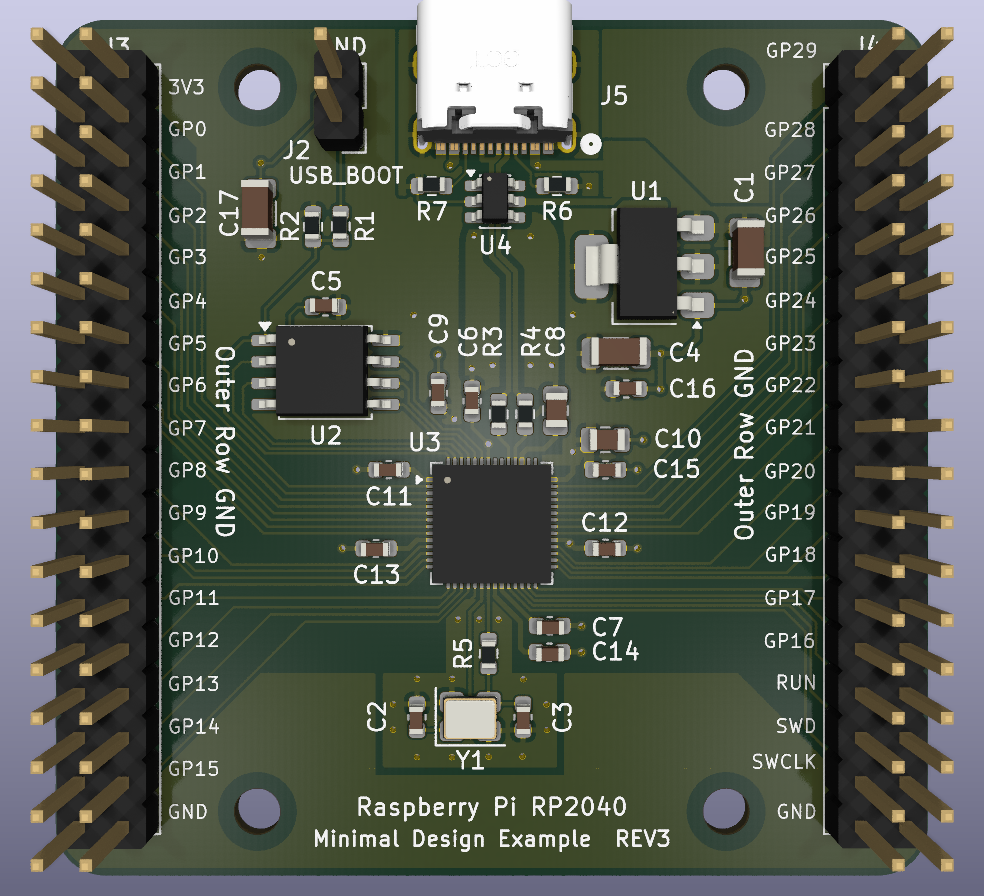
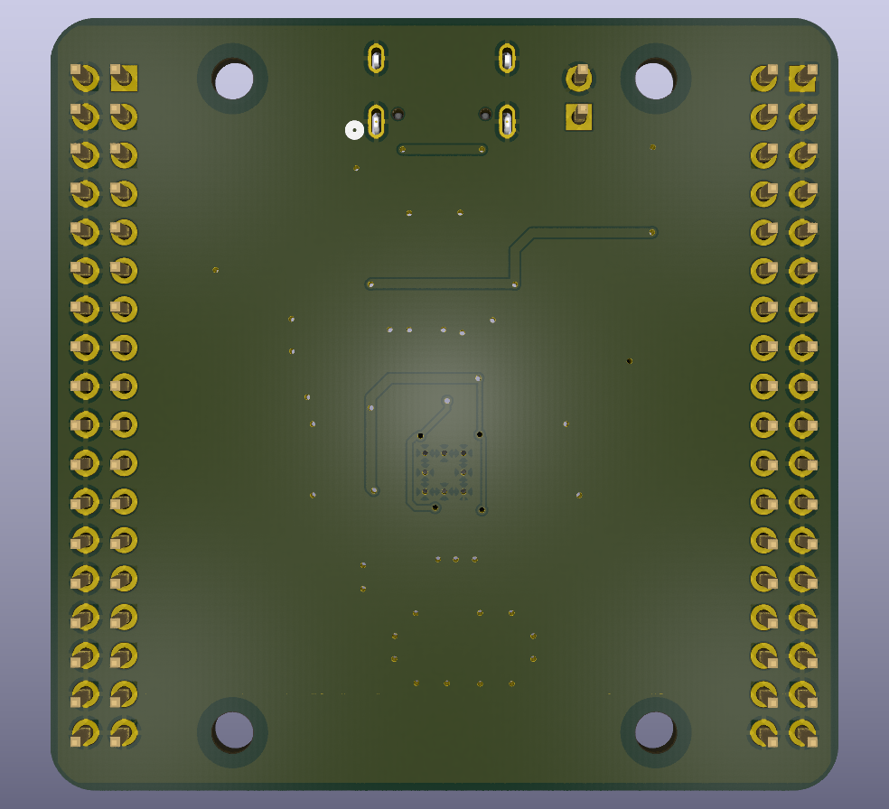
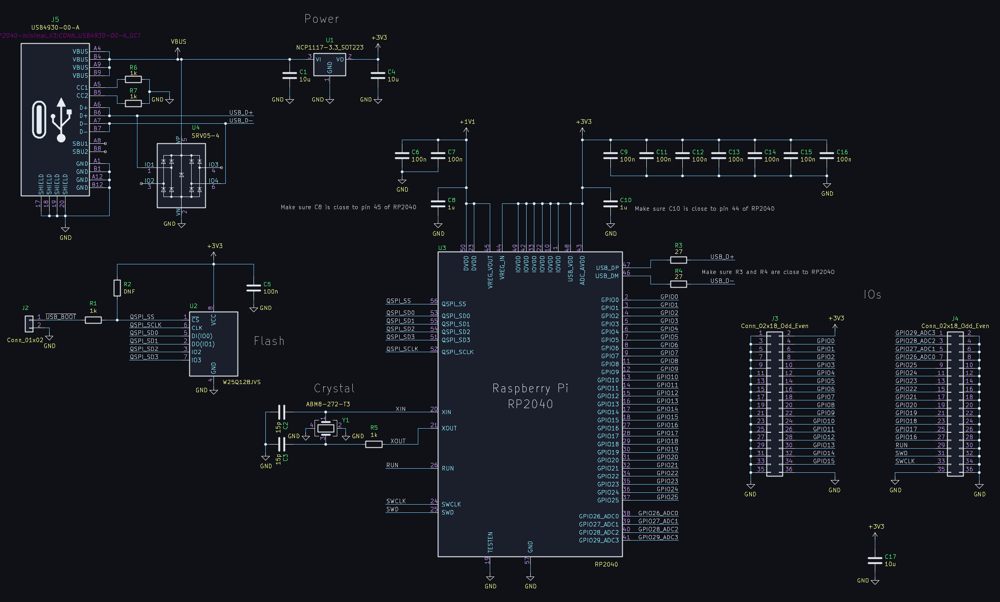
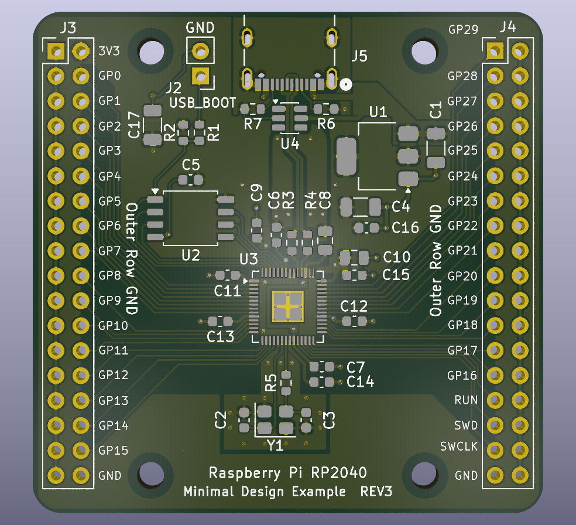
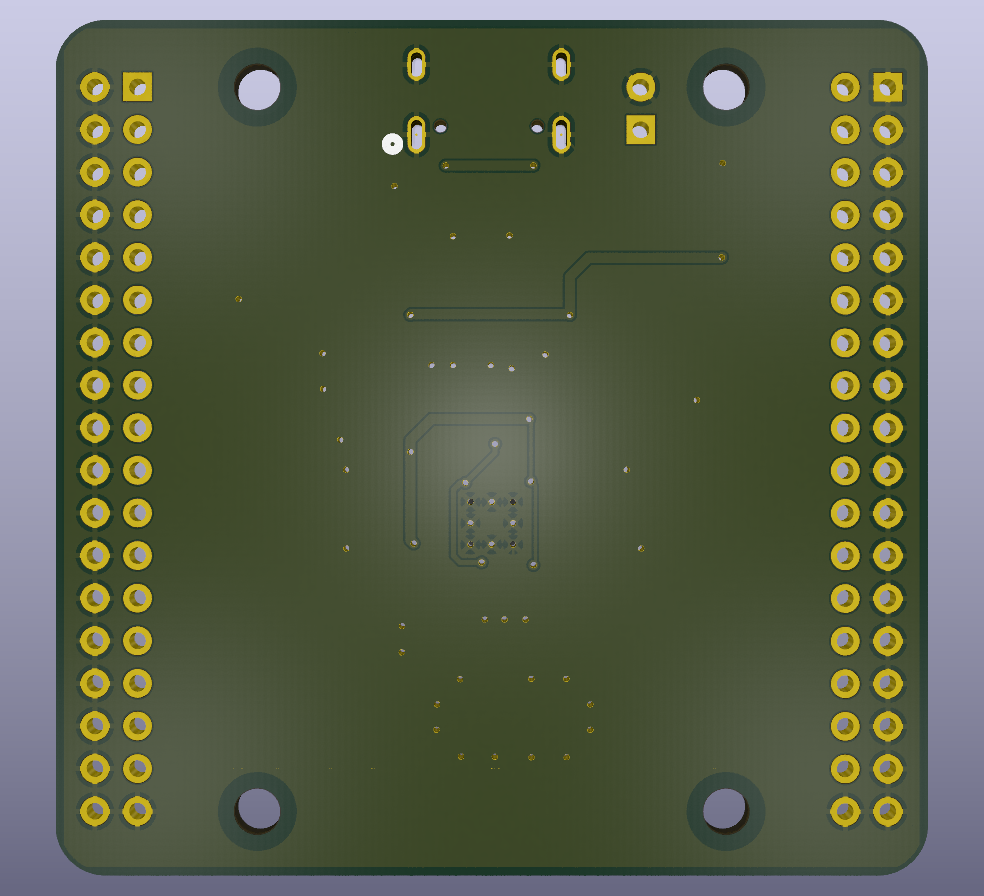

# RP2040 Minimal Project for KiCad

**RP2040 Minimal** is a circuit design based on Raspberry Pi's **RP2040** microcontroller, provided as a **KiCad** project. This repository contains the `RP2040_minimal-edit_V3` revision by [Gerald](https://community.element14.com/members/geralds), which retains the original PCB outline and GPIO connectors while updating the layout, component sizes, and USB interface.

| Front | Back |
| :---: | :---: |
|  |  |

## Design Overview

1. Uses a **USB Type-C** connector in place of the original Micro USB connector.
2. Uses `0603` components in place of `0402` parts for easier assembly.
3. Improves the PCB layout while retaining the original board outline and **GPIO connectors**.
4. Includes improved **ESD protection** at the USB interface.
5. Includes project-local **symbols**, **footprints**, and **3D models** for editing the design in KiCad.

## Notes

- Open [`minimal-edit_V3.kicad_pro`](./minimal-edit_V3.kicad_pro) in **KiCad** to work with the schematic and PCB layout.
- Keep the bundled library directories alongside the project; the symbol and footprint tables use project-relative paths.

## Technical Documentation

The repository includes the following design files and previews:

- [KiCad Schematic](./minimal-edit_V3.kicad_sch)
- [KiCad PCB Layout](./minimal-edit_V3.kicad_pcb)
- [Schematic Preview](./images/RP2040-minimal-Rev3_sch.png)

| Front PCB Layout | Back PCB Layout |
| :---: | :---: |
|  |  |

